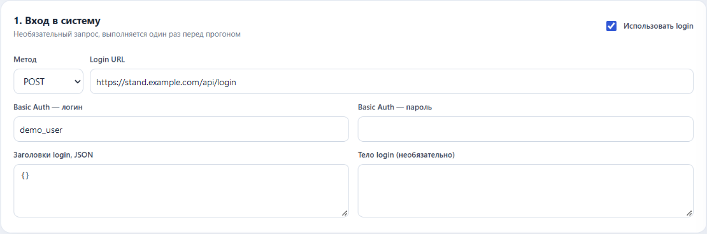
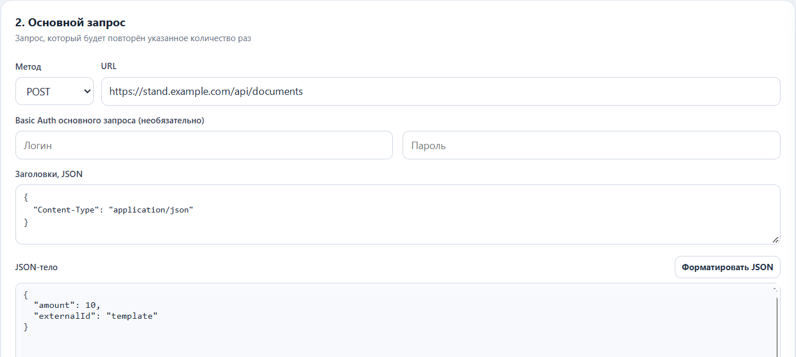
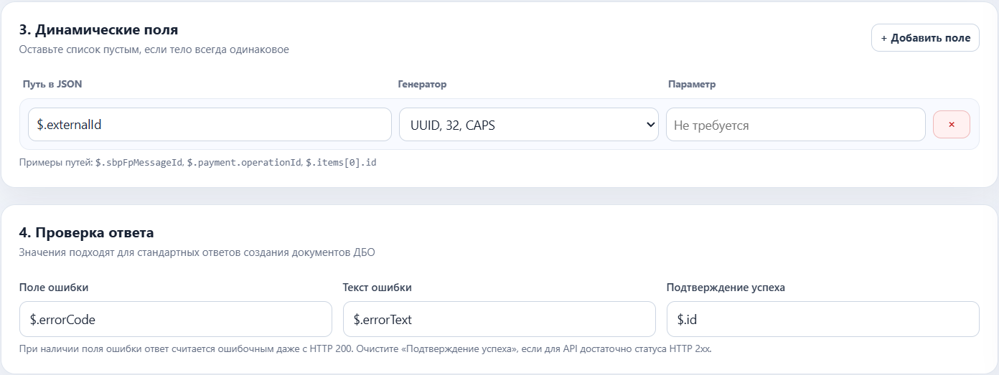
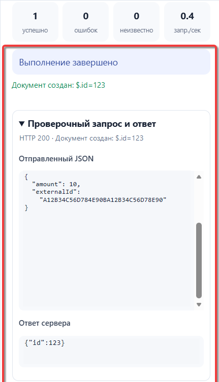

# iBatcher

Портативная утилита для Windows x64, которая массово создаёт тестовые данные через REST API. URL, метод, JSON-тело, динамические поля и правила проверки ответа задаются в профиле.

## Скачать и запустить

1. Откройте [GitHub Releases](https://github.com/snickers-stealer/iBatcher/releases) и в разделе **Assets** релиза **v1.1.0** скачайте `iBatcher-1.1.0-win64.zip`.
2. Распакуйте архив целиком. Папка `_internal` должна остаться рядом с `iBatcher.exe`.
3. Запустите `iBatcher.exe`. Утилита откроет интерфейс в браузере на `127.0.0.1`.

`iBatcher.exe` входит в готовую Windows-сборку. **Source code (zip)** содержит исходники. Для запуска готовой сборки Python и PyCharm не нужны.

## Быстрый старт

Если вашему API нужен отдельный запрос для входа, включите **Использовать login** в блоке **Вход в систему**. Укажите метод и URL, а если API использует Basic Auth, заполните логин и пароль. iBatcher выполнит вход перед прогоном и будет использовать полученные cookies для основного запроса.

Возьмите запрос создания записи для вашего тестового API. Если он уже настроен в Postman, перенесите его метод, URL, заголовки и тело в раздел **Основной запрос**.

1. **Заполните запрос.** Ниже условный пример. Подставьте адрес стенда и поля, которые принимает ваш API.

   | Поле | Пример значения |
   | --- | --- |
   | Метод | `POST` |
   | URL | `https://stand.example.com/api/documents` |
   | Заголовки, JSON | `{"Content-Type":"application/json"}` |
   | JSON-тело | `{"amount":10,"externalId":"template"}` |

   

2. **Настройте уникальное значение.** Если сервер требует уникальный `externalId`, в разделе **Динамические поля** добавьте путь `$.externalId` и выберите **UUID, 32, CAPS**. iBatcher подставит новый UUID при каждой отправке.

   

3. **Проверьте один запрос.** Нажмите **Проверить 1 запрос** и раскройте **Проверочный запрос и ответ**. Сверьте отправленный JSON, HTTP-статус и тело ответа. Например, при стандартных правилах HTTP 200 с ответом `{"id":123}` подтверждает создание, а непустой `errorCode` означает ошибку даже при HTTP 200. Если ваш API возвращает другие поля, задайте их в разделе **Проверка ответа**.

   

4. **Запустите серию.** Для первого прогона можно указать **Количество** `5` и **Потоки** `1`, затем нажать **Запустить прогон**.

Кнопка **Проверить 1 запрос** отправляет отдельный реальный запрос и может создать запись. Если в настройках прогона включено **Проверить первый запрос**, эта проверка входит в указанное количество запросов.

## Настройки и отчёты

- В **Динамических полях** доступны UUID, счётчики, время ISO и случайные строки. Можно указывать вложенные поля и элементы массивов, например `$.payment.operationId` и `$.items[0].id`.
- В разделе **Проверка ответа** стандартные пути задаются как `$.errorCode` для бизнес-ошибки, `$.errorText` для её текста и `$.id` для подтверждения создания. Если вашему API достаточно HTTP 2xx при отсутствии бизнес-ошибки, очистите поле **Подтверждение успеха**.
- Профили и отчёты хранятся в `data/profiles` и `data/reports` рядом с EXE. Кнопка **Отчёты** открывает папку отчётов.
- Чтобы полностью закрыть утилиту, нажмите **Закрыть программу**.

## Пауза и продолжение

Кнопка **Пауза** останавливает выдачу новых запросов и ждёт завершения текущих. Кнопка **Продолжить прогон** отправляет оставшиеся запросы с сохранёнными настройками. Если для входа нужен пароль, после перезапуска программы введите его повторно. Состояние хранится в `data/runs` рядом с EXE.

После обрыва запросы с неизвестным результатом автоматически не повторяются, поскольку сервер мог уже создать запись. Для POST таймауты и HTTP 5xx также не повторяются автоматически.

## Сборка из исходников

На Windows x64 с установленным Python откройте [build-release.cmd](build-release.cmd) двойным кликом. После сборки откроется папка `dist` с ZIP-архивом.
